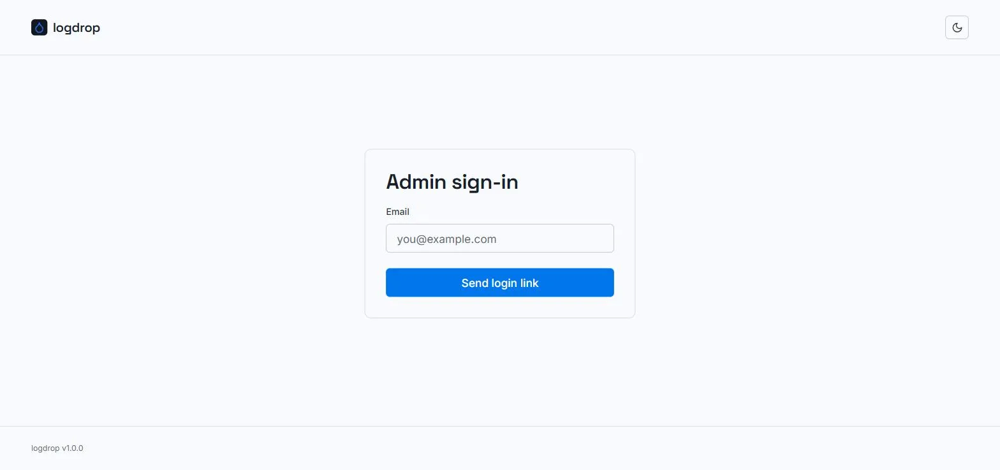

# Admin sign-in

logdrop has no passwords. Maintainers sign in with a **magic link** emailed to an address on the instance's allow-list (`ADMIN_EMAILS`).

---

## Signing in

1. Open `/admin` (or the **Admin** link in the top bar). You can also just open any upload link: without a session you're redirected to the sign-in page, and brought back to that upload afterwards.
2. Enter your email and click **Send login link**.
3. Open the email *"Your logdrop admin login link"* (with the logdrop logo and an *Admin sign-in* title) and click **Log in to logdrop** within **15 minutes**. If the button doesn't work, the same link is printed in plain text below it.
4. A confirmation page opens: click **Sign in**.
5. You land on the [admin dashboard](./admin-dashboard.md) (or the upload you were trying to open), signed in.

:::tip[Why the extra click]
Many mail systems (Microsoft Defender Safe Links and similar) open links in advance to scan them. Since 1.4.0 a login link works only once, so if opening it were enough, the scanner would use it up before you do. Opening the link only shows the **Sign in** button; the link is used when you press it.
:::

:::info[Same answer for everyone]
After you submit, the page always says *"If that email is registered, a login link is on its way"*, whether or not the address is on the allow-list. This is deliberate: the sign-in form can't be used to find out which addresses are admins. If no email arrives, double-check the address and your spam folder, then ask the instance operator whether you're on `ADMIN_EMAILS`.
:::

---

## Login links

- A login link works **once**, within **15 minutes** of being requested. Using it a second time, from any browser, is rejected.
- Requesting a new link cancels the previous one, even if you hadn't used it yet.
- The link doesn't contain your email address, only a random token. The instance stores just a hash of it, never the token itself.

## Sessions

- A session belongs to **one browser**. The cookie (`HttpOnly`, `Secure`) has no expiry date, so it ends when you close the browser session. Another browser, another device, or a browser reopened after the cookie is gone needs a new login link.
- Whatever the browser does with the cookie, the server ends every session **8 hours** after sign-in. Then sign in again.
- **One session per admin**: signing in on another browser or device ends your previous session there. The next page you open in the old browser sends you to the sign-in page.
- The allow-list is re-checked on **every request**. Removing an address from `ADMIN_EMAILS` revokes that admin's access immediately, without waiting for the session to expire.
- Sessions issued before 1.4.0 lasted 7 days and are no longer accepted: after the upgrade, every admin signs in once more.

## Signing out

Click **Sign out** at the top right of any admin page. The session ends on the server too, so the cookie stops working even if it was copied somewhere else. Your [agent token](./agent-api.md#personal-agent-tokens) isn't affected: it doesn't depend on your session.

## Error messages

| Message | What to do |
|---|---|
| *That link expired or was already used. Request a new one below.* | The link was already used (by you, or in another browser), is older than 15 minutes, was replaced by a newer request, or your address was removed from the allow-list. Request a new link. |
| *Missing login token.* | The link was truncated (common when copying it by hand). Click it directly from the email, or request a new one. |
