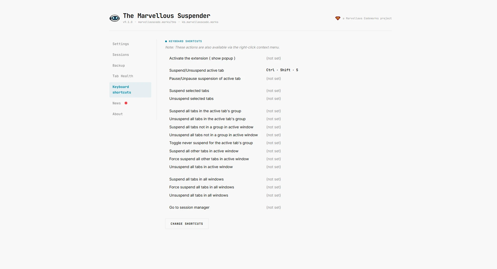
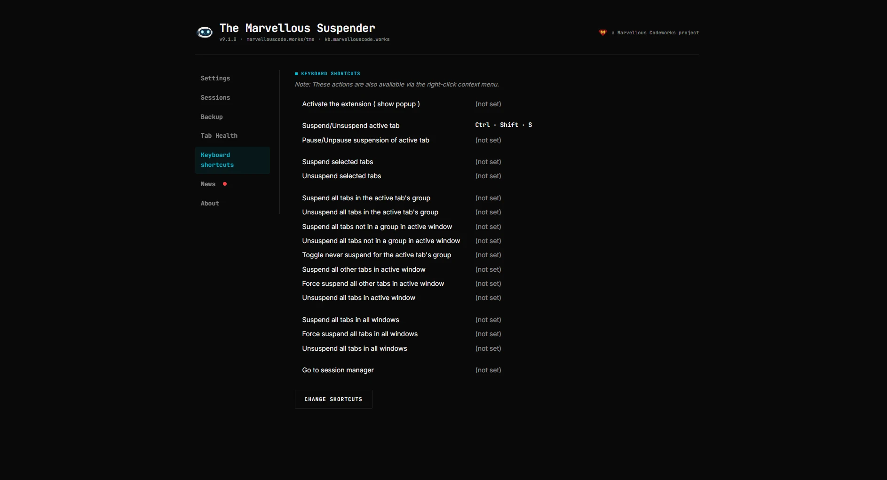

# Keyboard shortcuts

TMS ships with one pre-assigned shortcut. All other commands have no default key binding and must be assigned manually.

## Default shortcut

| Shortcut | Action |
|---|---|
| `Ctrl` + `Shift` + `S` | Toggle suspension of the current tab (suspend or unsuspend) |

## All available commands

| Command | Default key | Description |
|---|---|---|
| Suspend/Unsuspend active tab | `Ctrl+Shift+S` | Suspend the active tab, or unsuspend it if already suspended |
| Pause/Unpause suspension of active tab | - | Toggle the "paused" state for the current tab (excluded from auto-suspend until next reload) |
| Suspend selected tabs | - | Suspend all tabs currently selected in the tab strip |
| Unsuspend selected tabs | - | Unsuspend all tabs currently selected in the tab strip |
| Suspend all tabs in the active tab's group | - | Suspend every tab sharing the active tab's group. No-op on an ungrouped tab |
| Unsuspend all tabs in the active tab's group | - | Unsuspend every tab sharing the active tab's group. No-op on an ungrouped tab |
| Suspend all tabs not in a group in active window | - | Suspend every tab in the current window that isn't in a tab group |
| Unsuspend all tabs not in a group in active window | - | Unsuspend every tab in the current window that isn't in a tab group |
| Toggle never suspend for the active tab's group | - | Add the active tab's group to, or remove it from, the [never-suspended tab groups](./settings.md#never-suspend-tabs-in-the-following-tab-groups). Named groups only |
| Suspend all other tabs in active window | - | Suspend every other tab in the current window. Your protections still apply |
| Force suspend all other tabs in active window | - | Suspend every other tab in the current window, ignoring your protections (never-suspend list, pinned, audio and so on). The active tab stays as it is |
| Unsuspend all tabs in active window | - | Unsuspend all tabs in the current window |
| Suspend all tabs in all windows | - | Suspend every tab across every open window. Your protections still apply, including [Never suspend active tab in each window](./settings.md#never-suspend-active-tab-in-each-window) |
| Force suspend all tabs in all windows | - | Suspend every tab across every open window, active ones included, ignoring your protections |
| Unsuspend all tabs in all windows | - | Unsuspend all tabs across every open window |
| Go to session manager | - | Open the Session management page directly |

TMS also has its own read-only copy of this list on the **Keyboard shortcuts** page in the sidebar, with a **Change shortcuts** button that jumps straight to `chrome://extensions/shortcuts`. Labels follow your [language setting](./settings.md#language), shown here in Italian:

*Dark theme:*

## Assigning shortcuts

1. Navigate to `chrome://extensions/shortcuts` in your browser.
2. Find **The Marvellous Suspender** in the list.
3. Click the input field next to the command you want to assign and press your desired key combination.

:::tip
Chrome limits extension shortcuts to combinations using `Ctrl` (or `Cmd` on Mac) and/or `Alt`, plus at least one other key. Shortcuts that conflict with browser-reserved combinations cannot be assigned.
:::

## Changing the default shortcut

The `Ctrl+Shift+S` default for "Suspend/Unsuspend active tab" can also be reassigned from the same `chrome://extensions/shortcuts` page if it conflicts with another application or extension.
