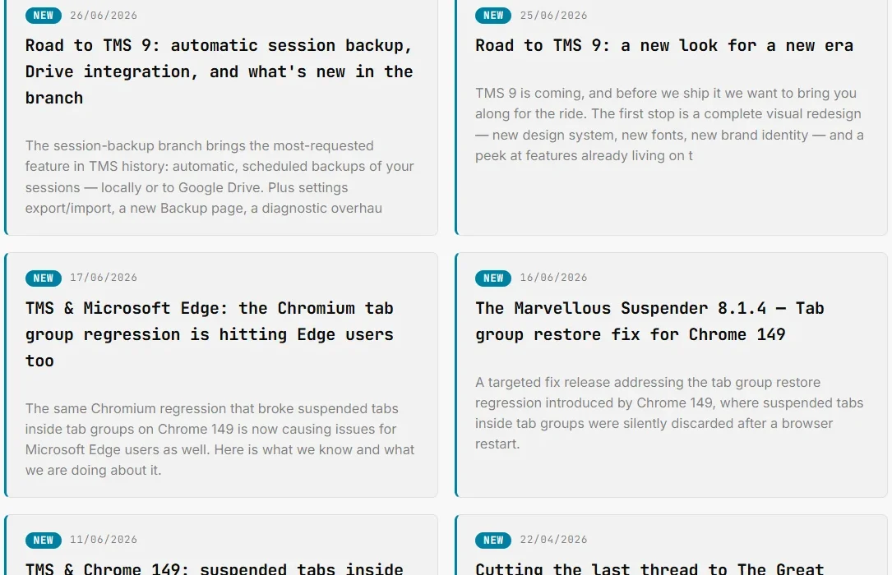
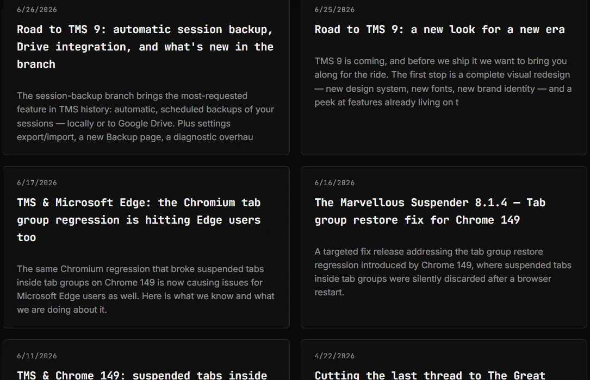
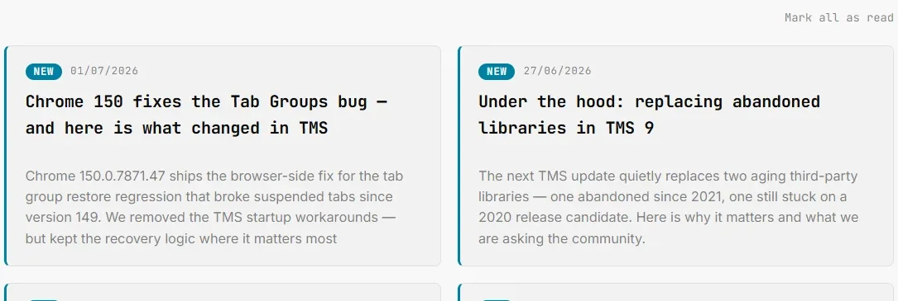
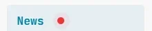

# News feed

Open the News page from the left sidebar (**News**). Available in Incognito windows too.

News is a lightweight, built-in reader for the Marvellous Codeworks blog, release notes, deep-dives and announcements about TMS, without requiring you to visit the site or subscribe to anything separately.

*Dark theme:*

---

## Where the content comes from

TMS periodically fetches the RSS feed at `kb.marvellouscode.works/blog/rss.xml` and shows only the entries tagged **"The Marvellous Suspender"**, posts about other Marvellous Codeworks products are filtered out automatically. Up to 10 items are shown, laid out as a 2-column grid with title, excerpt, publication date and a link to the full article.

The feed is cached locally (`chrome.storage.local`) for up to 24 hours and refreshed automatically once a day by a background alarm, at a time that's randomized once per installation (to avoid every user's browser hitting the blog's server at the same minute). Opening the News page also triggers an immediate refresh if the cache is stale.

No fetch happens more often than the cache allows, there is no way to "poll" the feed faster from the UI. If you need to force an immediate check (e.g. right after publishing verified you're testing), see the [Diagnostic page](./diagnostic-page.md#news-feed).

---

## Unread tracking

- New articles are marked with a blue left border and a **NEW** pill next to the date, merely opening the News page does **not** mark anything as read.
- Clicking an article's title link marks that one article as read and removes the highlight.
- **Mark all as read** appears above the grid whenever at least one article is unread, and disappears once everything has been read.

- A small red badge dot appears next to **News** in the left sidebar on every extension page whenever unread articles exist, updating live if the feed refreshes while you have a page open, no reload needed.

---

## Disabling the news feed

If you'd rather not have TMS make this background request at all, turn off **Enable news feed** in [Settings → General](./settings.md#enable-news-feed). Enabled by default. Disabling it immediately clears the scheduled refresh alarm, stops all fetches, and hides the **News** entry from the left sidebar on every page. Re-enabling it restores the sidebar entry and resumes fetching on the normal schedule, the feed picks up new articles on the next check since disabling doesn't affect what counts as "unread."

---

## Related

- [Diagnostic page](./diagnostic-page.md#news-feed): shows the last fetch time, unread count, next scheduled run and this device's randomized refresh time slot; also offers a manual force-refresh (unpacked/developer builds only)
