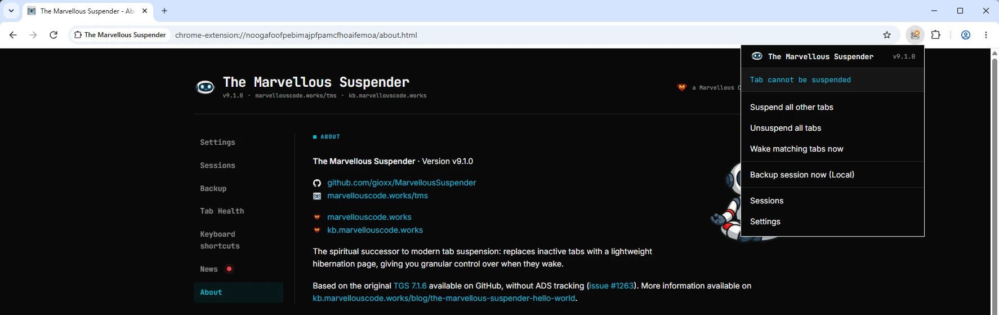
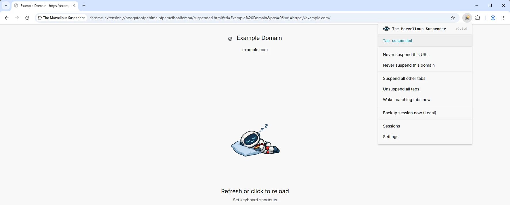
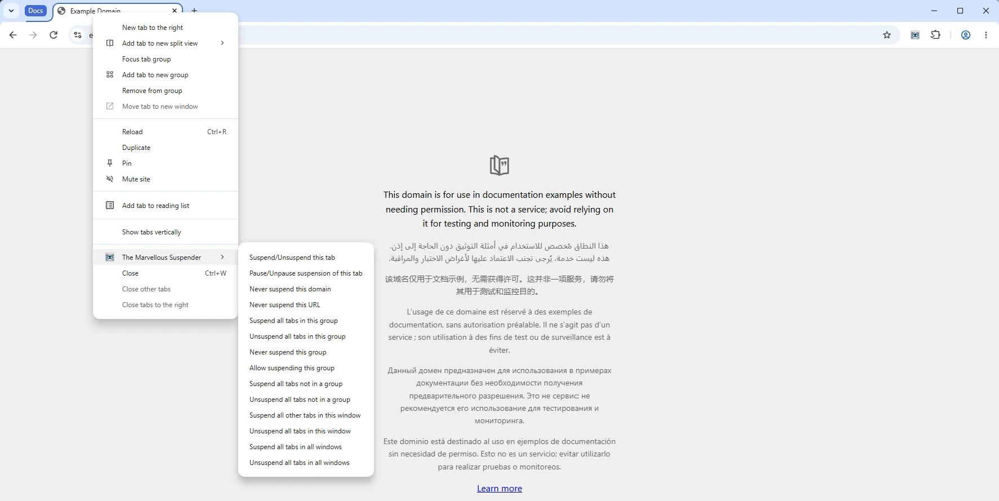

# Toolbar popup & quick actions

Click the TMS icon in the browser toolbar to open the popup. It's the fastest way to act on the current tab, on selected tabs, or on all tabs, without opening a full extension page. The same actions (plus a couple of extras) are also available from the right-click context menu on any tab, if [enabled in Settings](./settings.md#add-the-marvellous-suspender-to-right-click-context-menu).

---

## Status line

At the top of the popup, TMS shows the current tab's status and, for several statuses, an inline action link:

| Status shown | Meaning | Inline action |
|---|---|---|
| Tab will suspend automatically. | Tab will be suspended automatically per your timer | **Not now** - excludes this tab from auto-suspend until it's next reloaded |
| Tab suspended | Tab is already suspended | - |
| Automatic tab suspension disabled. | Auto-suspend is disabled ([Automatically suspend tabs after](./settings.md#automatically-suspend-tabs-after) = Never) | - |
| Site allowed. | Tab's URL matches an entry in your [never-suspend list](./settings.md#never-suspend-tabs-with-urls-from-the-following-list) | **Remove from allowlist** |
| Tab cannot be suspended | An internal/unsuspendable page (e.g. `chrome://`, the Chrome Web Store) | - |
| Tab is playing audio. | Tab is playing audio and is excluded from auto-suspend | - |
| Tab is receiving form input. | TMS detected an active, unsaved form and is excluding the tab | **Unpause** |
| Tab has been pinned | Tab is pinned and excluded from auto-suspend | - |
| Tab suspension paused. | You manually paused this tab | **Unpause** |
| No network connection | Browser is offline and [Never suspend tabs when offline](./settings.md#never-suspend-tabs-when-offline) is enabled | - |
| Connected to power source | Device is on power and [Never suspend tabs when connected to power source](./settings.md#never-suspend-tabs-when-connected-to-power-source) is enabled | - |
| Tab is open in an app window | Tab is open in an [app-mode window](./settings.md#never-suspend-tabs-opened-in-app-windows) and excluded from auto-suspend | - |
| Tab is in a tab group | Tab is in a tab group and [Never suspend tabs in a tab group](./settings.md#never-suspend-tabs-in-a-tab-group) is enabled | - |
| Tab is in a group that is never suspended | Tab is in a group you marked with [Never suspend this group](./settings.md#never-suspend-tabs-in-the-following-tab-groups) | - |
| Local files cannot be suspended. | TMS doesn't have access to local `file://` pages | **Enable** → opens the [local file permissions page](#local-file-permissions) |

When the current tab won't be suspended automatically (paused, allowed, pinned and so on), the toolbar icon itself shows a small orange pause badge in its top-right corner, so you can tell without opening the popup. The badge also appears on pages that can't be suspended at all, such as the browser's own pages or a tab that is already suspended. With the [classic artwork](./settings.md#use-the-classic-the-great-suspender-artwork-instead-of-the-new-mascot) the paused icon is the original grey one instead.

If a scheduled Google Drive backup recently failed, a red banner appears above the menu, click it to jump straight to [Backup & Restore](./backup-sync.md) and reconnect.

Example of the **Tab cannot be suspended** status, shown here on an internal extension page (dark theme):

---

## Current tab

| Menu item | Effect |
|---|---|
| **Unsuspend this tab** | Reloads the current tab in its normal state (shown only if suspended) |
| **Suspend this tab now** | Suspends the current tab immediately, bypassing the inactivity timer |
| **Never suspend this URL** | Adds the exact URL to the [never-suspend list](./settings.md#never-suspend-tabs-with-urls-from-the-following-list) |
| **Never suspend this domain** | Adds the domain (matches all pages on it) to the never-suspend list |

## Selected tabs

Shown only when more than one tab is highlighted in the tab strip (`Shift`/`Ctrl`-click).

| Menu item | Effect |
|---|---|
| **Suspend selected tabs** | Suspends every highlighted tab |
| **Unsuspend selected tabs** | Unsuspends every highlighted tab |

## All tabs

| Menu item | Effect |
|---|---|
| **Suspend all other tabs** | Suspends every tab in the current window except the active one (your protections still apply, see [keyboard shortcuts](./keyboard-shortcuts.md) for the "force" variant, which ignores them) |
| **Unsuspend all tabs** | Unsuspends every tab in the current window |
| **Wake matching tabs now** | Unsuspends only the tabs in the current window that match an entry in your never-suspend list, useful right after editing that list |

## Backup

Shown only when [automatic backup](./backup-sync.md#automatic-session-backup) is enabled in Settings. The label reflects your configured destination:

| Label | Effect |
|---|---|
| **Backup session now (Local)** | Immediately runs a local session backup |
| **Backup session now (Cloud)** | Immediately runs a Google Drive session backup |

## Navigation

| Menu item | Effect |
|---|---|
| **Sessions** | Opens [Session management](./session-management.md) in a new tab |
| **Settings** | Opens [Settings](./settings.md) in a new tab |

---

## Right-click context menu

If **Add The Marvellous Suspender to right-click context menu** is on in [Settings → General](./settings.md#add-the-marvellous-suspender-to-right-click-context-menu), right-clicking any tab (or a link on a page) exposes the same current-tab and bulk actions found in the popup, plus these extras not present in the popup:

| Context menu item | Effect |
|---|---|
| **Open Link in New Suspended Tab** | Right-click a hyperlink on any page to open it directly in a new, already-suspended tab, without ever loading it live |
| **Pause/Unpause suspension of this tab** | Equivalent to the popup's Pause/Unpause action, available as a direct one-click toggle |
| **Suspend all tabs in this group** | Suspends every tab sharing the right-clicked tab's group. Available both in the page context menu and by right-clicking a tab in the tab strip; no-op on an ungrouped tab |
| **Unsuspend all tabs in this group** | Unsuspends every tab sharing the right-clicked tab's group. Same availability and no-op behavior as above |
| **Suspend all tabs not in a group** | Suspends every tab in the window that isn't in a tab group. Your protections (never-suspend list, pinned, audio, app windows, unsaved forms) still apply |
| **Unsuspend all tabs not in a group** | Unsuspends every tab in the window that isn't in a tab group |
| **Never suspend this group** / **Allow suspending this group** | Adds the right-clicked tab's group to, or removes it from, the [never-suspended tab groups](./settings.md#never-suspend-tabs-in-the-following-tab-groups). Named groups only |

The context menu is unavailable in Incognito windows regardless of the setting. Items in the tab strip menu (right-clicking a tab itself, rather than the page) need a browser that supports them; on Chrome 147 and older only the page menu is available.

---

## Local file permissions

To suspend pages opened from local `file://` URLs, TMS needs access to them. Without it, the popup shows **Local files cannot be suspended.** with an **Enable** link that opens TMS's own permissions page, see [System & recovery pages](./system-pages.md#local-file-permissions-page) for how to grant it.
