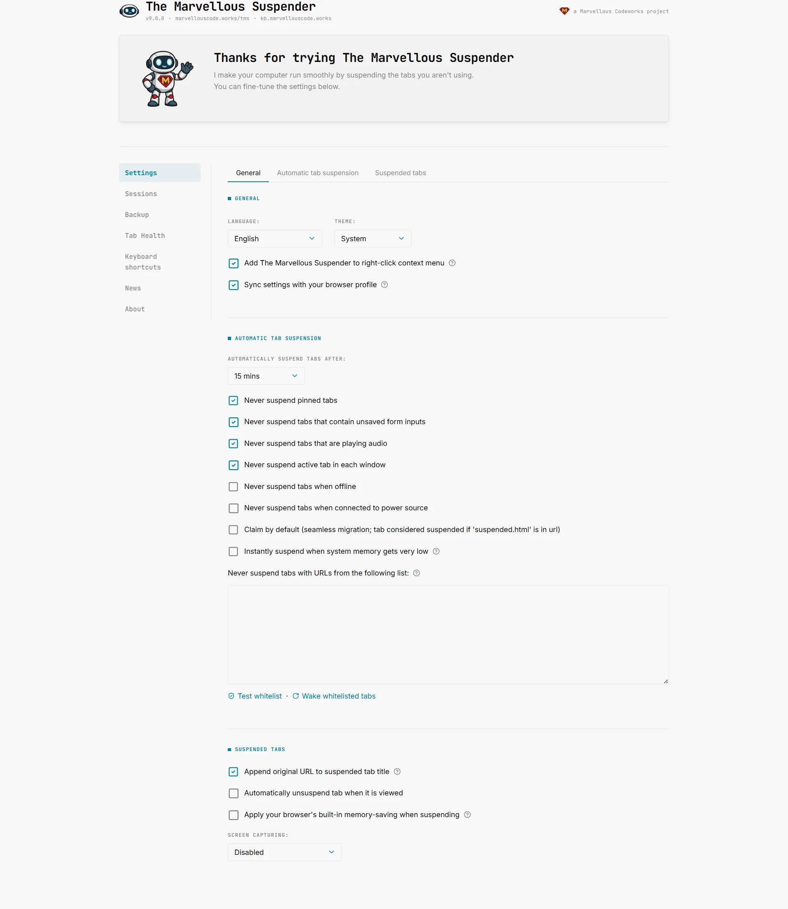
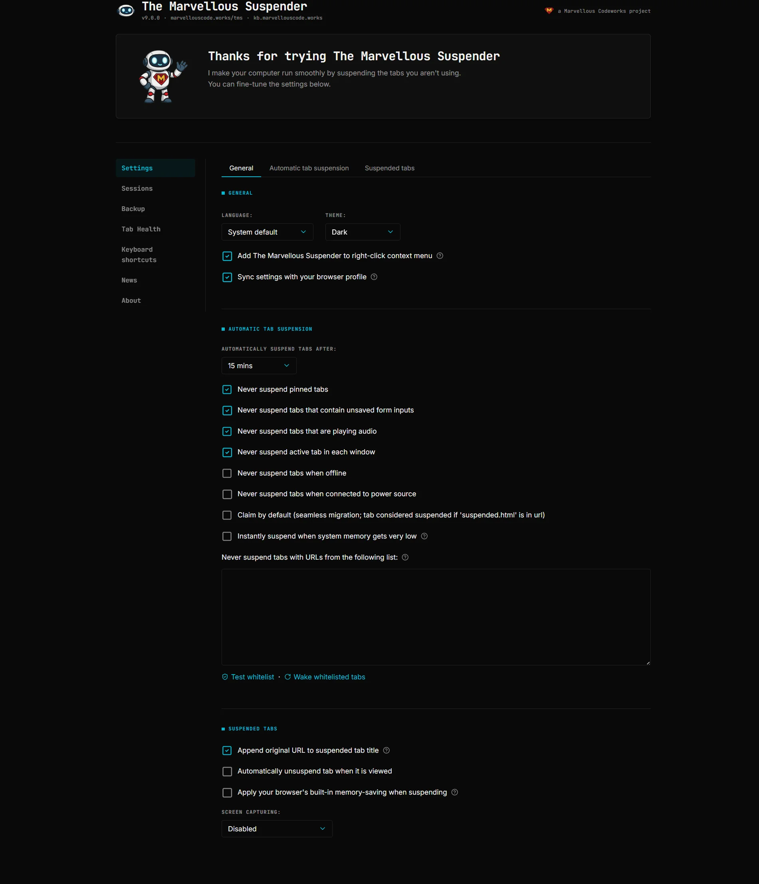

# Settings reference

Open the TMS settings page from the extension popup or by navigating to `chrome://extensions/` → TMS → **Details** → **Extension options**.

This page (`options.html`) covers general behavior, automatic suspension and the suspended-tab page. Automatic backups and session restore live on their own dedicated pages, see [Backup & Sync](./backup-sync.md) and [Session Management](./session-management.md).

*Dark theme (also showing the Theme dropdown set to Dark):*

---

## General

### Language
Controls the language used throughout the extension UI. Set to **System** (default) to follow your browser's locale, or pick a specific language from the list.

TMS is available in Arabic, Chinese (Simplified and Traditional), Czech, English, French, German, Indonesian, Italian, Japanese, Portuguese (Brazil and Portugal), Russian, Sinhala, Slovak, Spanish, Turkish and Ukrainian. Translations are managed and kept up to date via [Crowdin](https://crowdin.com/project/tms); the dropdown in Settings always shows the current list.

### Theme
Controls the appearance of the suspended tab page.

| Value | Behavior |
|---|---|
| **System** (default) | Follows your OS light/dark preference automatically |
| **Light** | Always uses the light theme |
| **Dark** | Always uses the dark theme |

### Enable context menu
Adds TMS commands to the browser's right-click context menu on tabs. Disabled in Incognito windows.

### Sync settings across devices
Syncs your TMS configuration via your Google account using Chrome's sync storage. Useful if you use Chrome on multiple computers.

:::note
Sync has a storage size limit. If your never-suspend list is very large, sync may not work reliably. In that case, use [Backup & Sync](./backup-sync.md#settings-backup) instead, it can save your full settings file to a local file or to Google Drive, with no size restriction.
:::

### Enable news feed
Enabled by default. Controls whether TMS periodically checks `marvellouscode.works` for TMS-related posts and shows them on the [News](./news-feed.md) page. Disable this to stop the background request entirely, no fetches happen and the **News** entry disappears from the sidebar on every page until you turn it back on.

### Use the classic The Great Suspender artwork
Disabled by default. Swaps TMS's current robot mascot/icon set back to the original The Great Suspender artwork app-wide: toolbar icon, suspended-tab favicon fallback, and every extension page's images and favicon. Illustrations with no legacy equivalent keep using the new artwork.

---

## Suspend

:::note[What overrides the "Never suspend…" options]
Each **Never suspend…** option has a help icon that says what can still override it. These options protect a tab from automatic suspension and from the regular bulk suspend actions. You can still suspend a tab yourself, or with a **Force suspend** action, and a tab whose URL is on the [always suspend list](#always-suspend-list) is suspended anyway. The one exception is [Never suspend active tab in each window](#never-suspend-active-tab-in-each-window): the always suspend list does not override it for automatic and bulk suspension.
:::

### Automatically suspend tabs after
How long a tab must be inactive before TMS suspends it. Options range from 20 seconds to 2 weeks. Set to **Never** to disable automatic suspension.

### Suspend tabs on battery power after
Defaults to **Same as when plugged in** (no override). Lets you suspend tabs more aggressively while running on battery than your normal AC timeout, without changing that AC timeout. Only takes effect while the device is actually unplugged; ignored while charging.

### Never suspend pinned tabs
Pinned tabs are excluded from automatic suspension.

### Never suspend tabs opened in app windows
Enabled by default. Covers both a page opened via Chrome's **Create Shortcut → Open as window** (or the browser menu's **Install page as App**) and an installed PWA (**Install `<site>`** from the address bar), each opening in its own dedicated window rather than a normal tab. Deliberately does not extend to ordinary popup windows a site opens itself. A manual "suspend this tab now" still works regardless, only automatic suspension respects this setting.

### Never suspend tabs in a tab group
Disabled by default. Keeps every tab that belongs to a tab group from being suspended automatically or by the bulk suspend actions; **Suspend all tabs in this group** does nothing while this is on. A tab you drag out of its group becomes eligible again and its inactivity timer starts over. To protect only some groups, use the [tab group list](#never-suspend-tabs-in-the-following-tab-groups) instead.

### Never suspend tabs that contain unsaved form inputs
TMS detects whether a tab contains an active form with unsaved input and skips it. Useful for forms that don't auto-save.

### Never suspend tabs that are playing audio
Tabs that are currently playing audio (music, video, calls) are excluded.

### Never suspend active tab in each window
The currently focused tab in every open window is never suspended automatically.

### Never suspend tabs when offline
TMS will not suspend tabs when the browser detects no network connection.

### Never suspend tabs when connected to power source
Suspension only happens when the device is running on battery, not when plugged in.

### Claim tabs suspended by other extensions
When TMS is updated or reloaded, it automatically takes ownership of any already-suspended tabs it finds. Disable this if you manage multiple suspender extensions and want explicit control.

### Instantly suspend when system memory gets very low
When Chrome is about to discard a tab due to memory pressure, TMS intercepts the action and suspends the tab instead (preserving the URL on a TMS page). Discarded tabs are harder to recover than suspended ones.

### Never-suspend list
A list of URL patterns that TMS will never suspend automatically, labeled on the page as "Never suspend tabs with URLs from the following list". Referred to as the **allowlist** throughout the UI. One pattern per line. Supports:
- Full URLs: `https://mail.google.com`
- Domain patterns: `google.com` (matches all pages on that domain)
- Regular expressions: `/^https:.*google\.com/`

Use the test link below the text area to check whether a given URL would be matched, and **Wake matching tabs now** to immediately unsuspend any currently-suspended tab in the window that matches an entry you just added.

### Always suspend list
A second list, right next to the allowlist, labeled "Always suspend tabs with URLs from the following list". Tabs matching it always suspend after the normal timeout, bypassing the **Never suspend…** options (pinned, audio, unsaved forms, app windows, tab groups) that would otherwise keep them open indefinitely, except the [active tab one](#suspend), useful for something like a background Twitch or YouTube tab left playing audio that you still want suspended on schedule. Manual per-tab pauses and global protections (offline, charging, "never suspend") are still respected, this only overrides the passive automatic ones.

Same matching rules as the allowlist above (plain text or `/regex/`). Comes with its own **Suspend matching tabs now** button, mirroring the allowlist's wake button, to immediately suspend any open tab that matches an entry you just added instead of waiting for the normal timeout.

### Never suspend tabs in the following tab groups
The tab groups you have marked with **Never suspend this group** from the [right-click menu](./quick-actions-popup.md#right-click-context-menu) or its [keyboard shortcut](./keyboard-shortcuts.md). Tabs in these groups are never suspended automatically and are skipped by the bulk suspend actions, **Suspend all tabs in this group** included. Suspending a tab yourself still works, and a URL on the always suspend list is still suspended.

- **Only named groups can be added.** Give the group a name in the browser first; until then the page right-click menu shows the item greyed out as **Never suspend this group (named groups only)**.
- **Groups are matched by name and colour**, so two open groups with the same name and colour count as one: marking one marks both. Each entry shows how many open groups it currently matches.
- **Renames are followed** while the browser stays open: renaming a marked group keeps it protected under its new name.
- To undo, use **Allow suspending this group** from the right-click menu, or **Remove** next to the entry in this list.

---

## Suspended Tabs

### Append original URL to suspended tab title
Enabled by default. Appends the original page URL to the browser tab's underlying `document.title` (not the visible text on the suspended page itself) so that Chrome's **Search Tabs** feature (`Ctrl+Shift+A`) can find a suspended tab by typing its hostname, not just its page title.

### Preserve YouTube playback position when suspending
Saves your current playback timestamp before suspending a YouTube tab and resumes from there on unsuspend, instead of restarting the video from the beginning.

### Always reopen suspended tabs scrolled to the top
Disabled by default. Skips restoring the saved scroll position on unsuspend, the tab always reopens at the top of the page instead. Applies to both automatic and manual suspension, and overrides any `#section` link anchor in the URL.

### Automatically unsuspend tab when it is viewed
When you switch to a suspended tab, TMS immediately starts loading it without requiring you to click. Convenient if you switch tabs frequently and want seamless restoration.

### Reload also unsuspends tabs in the background (not just the active tab)
Disabled by default. Normally, reloading a suspended tab only counts as an explicit "unsuspend" request when that tab is the one currently focused. Enable this to also recognize a reload on a suspended tab you're not currently looking at (e.g. via a multi-tab selection, or right-click → Reload on an inactive tab) as an unsuspend request.

### Apply your browser's built-in memory-saving when suspending
After TMS suspends a tab (converting it to the TMS suspended page), it also tells Chrome to discard the tab from memory. This achieves maximum memory savings but means Chrome must reload the TMS page itself when you switch back to the tab.

### Screen capturing
Controls whether TMS takes a picture of the page before suspending it, which is then shown as a preview on the suspended tab page.

| Value | Behavior |
|---|---|
| **Disabled** (default) | No preview image |
| **Capture top of screen only** | Captures the part of the page visible in the window |
| **Capture entire page** | Captures the full length of the page |

TMS makes a preview in one of two ways:

- **Browser screenshot**: a real screenshot taken by the browser. It is almost instant and looks exactly like the page, but the browser only allows it for the tab currently shown in its window, and it only ever covers the visible part of the page, even with **Capture entire page** selected.
- **Page renderer**: TMS redraws the page inside the tab with [SnapDOM](https://github.com/zumerlab/snapdom). It works on any tab, including ones in the background, but it is slower, especially in background tabs, which the browser slows down. If the render takes longer than 20 seconds (45 seconds with [high quality mode](#enable-high-quality-screen-capture-mode)), the tab is suspended without a preview. Web fonts are not embedded, so text in the preview may use a different font than the page.

A tab the browser has already discarded to save memory is suspended as it is: TMS does not reload it just to take a preview.

If tabs take a long time to suspend or the browser feels slow with screen capturing on, try turning it off.

### Capture method
Chooses how previews are made. Only applies when **Screen capturing** is on.

| Value | Behavior |
|---|---|
| **Automatic (recommended)** (default) | Takes a browser screenshot when the tab being suspended is the one shown in its window, typically when you suspend the tab you are looking at from the popup, a keyboard shortcut or the right-click menu. Every other tab goes to the page renderer. If the screenshot isn't possible, the page renderer takes over; if the page renderer fails on a visible tab, a screenshot of the visible part is kept instead |
| **Browser screenshot only** | Never runs the page renderer. Tabs suspended in the background get no preview, and suspending costs nothing extra |
| **Page renderer only** | Always uses the page renderer, never a browser screenshot |

### Keep a recent screenshot of tabs as I use them
Disabled by default. About a second after you switch to a tab, or after it finishes loading, TMS takes a browser screenshot of it and keeps it. When that tab is later suspended in the background, the saved screenshot becomes its preview, instead of a slower page render.

- **Permission**: the browser only lets an extension take these screenshots if it has access to all sites, so turning this on asks for that permission, see [Permissions](../permissions.md#all-sites-access-for-recent-screenshots). Turning it off deletes the saved screenshots and gives the permission back; turning it on again asks again. On a synced device where the permission was never granted, the option has no effect.
- **What is kept**: only the latest screenshot of each open tab, stored in your browser profile. It is deleted when the tab closes, navigates to another page or is suspended.
- **Never captured**: Incognito tabs and sites on your [never-suspend list](#never-suspend-list).

### Enable high quality screen capture mode
Disabled by default. With this off, previews are captured at a lower quality and a full-page capture is limited to 5000 px in height. Turning it on gives better previews and allows the page renderer more time, at the cost of more CPU and memory.

### Suspended tabs checked at a time when the browser starts
When the browser starts, TMS checks each restored suspended tab and repairs it if needed. It checks a few at a time, the tab you are looking at first, and leaves tabs the browser keeps asleep untouched, which is why titles and favicons can take a moment to fill in after a restart.

From 1 to 8, default **3**. A higher number fills in titles and icons sooner. The change takes effect at the next check of restored tabs, normally the next browser start.

:::warning
Raising this above 3 can overload the browser when it restores many tabs and bring back the freezes and crashes at startup that the default prevents. Change it at your own risk.
:::
